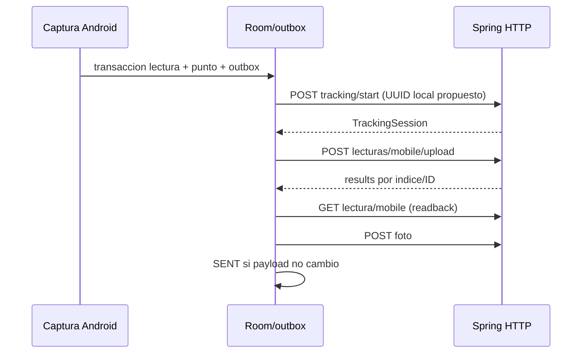

# Auditoria de sincronizacion (2026-10-13)

Inspeccion realizada antes de modificar contratos. No se accedio a produccion.

## Contratos comprobados

- POST /lecturas/mobile/upload recibe un array LecturaUploadItemDto, query usumodi. HTTP 200 con ok/error/total/details, confirmedIds/pendingIds/results; HTTP 200 no confirma todo el lote.
- PUT /lecturas/{id}/mobile recibe el mismo DTO; GET devuelve LecturaDto para readback.
- POST /tracking/start recibe TrackingSessionDto (id, readerId, deviceId, routeId, workDate). El backend adopta id como PK y devuelve TrackingSession: el UUID local propuesto solo es remoto confirmado despues del acuse HTTP. No hay un UUID distinto generado por servidor.
- POST /tracking/points/batch devuelve status=OK. Puntos usan clientPointId para deduplicar. POST /tracking/finish cierra sesion.
- POST /mobile/sync/download es el endpoint integral real. /lecturas/by-rutas es POST y devuelve 410; /lecturas/by-usuario-emision es POST.
- El prefijo /api depende del despliegue/baseUrl; no esta en los mappings de controladores.

## Secuencia observada

## Causa sustentada en codigo

MobileReadingTraceValidator rechaza IDs que no son UUID canonicos antes de consultar sesiones. TrackingServicio.startSession acepta historicamente IDs arbitrarios: inconsistencia real. El movil mantiene referencias numericas/alias antiguas. El upload actual ignora HTTP/body de start e incluso sigue despues de timeout: puede enviar una dependencia inexistente. Un UUID sintacticamente correcto no acredita registro remoto. Los mensajes de fecha comparan captura en Guayaquil con workDate; una captura del 12 de octubre vinculada al 14 de septiembre es una dependencia incoherente, no un efecto de puntos pendientes.

Las llamadas start se repiten por lectura/worker porque no hay confirmacion persistida. No demuestra duplicados: id es PK. Sin bloqueo concurrente, findById seguido de save no protege la carrera ni valida fecha/dispositivo del registro existente.

## Riesgos encontrados

Outbox PENDING/ERROR/SENT no distingue errores definitivos; worker reintenta mientras quedan errores. No operationId persistido, no recibo de lectura transaccional. Auditoria usa REQUIRES_NEW y WebSocket se notifica antes del commit: timeout/reenvio puede repetir efectos. Las fotos mantienen referencia local pero volver a enviar datos tras fallo de foto repite la operacion. Descarga protege lecturas pendientes; clientes/rutas/abonados se borran dentro de descarga integral y requieren merge. Logging BODY puede exponer payload/ubicacion. Room v16 con migraciones 12->15->16, sin fallback destructivo. UI Cambios pendientes ya tiene errores/reintento; no requiere frontend web para cambios compatibles.

## Decisiones antes de cambios

Conservar endpoints/HTTP y ampliar DTO con operationId opcional. Registrar recibo en misma transaccion que lectura/auditoria y notificar despues del commit. Serializar registro de sesion por su PK en PostgreSQL, validar identidad y persistir confirmacion Android. Expandir Room sin borrar cola. Separar NEEDS_REPAIR/AUTH_REQUIRED de reintentos temporales, conservar SENT local. No introducir GPS fallback ni cursor incremental. SQL expansivo se entrega para revision y respaldo, no se ejecuta en produccion. Tests de dispositivo/PostgreSQL reales dependen de disponibilidad local y se reportaran sin afirmar ejecucion si no ocurre.

## Estado final

La secuencia anterior describe el comportamiento previo. La implementaci?n final sustituye readback por recibo de operaci?n y separa confirmaci?n de datos y foto. Ver CONTRATOS_Y_ESTADOS.md, PRUEBAS_Y_RESULTADOS.md y DEPLOY_ROLLBACK.md. Pruebas locales con emulador y PostgreSQL completadas; piloto f?sico pendiente.
